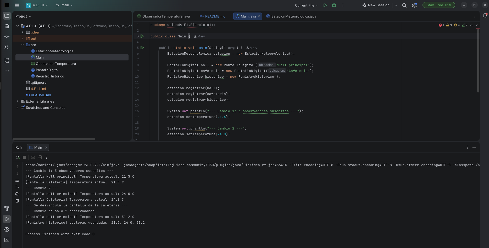

# Ejercicio 4.E1.01 – Estación Meteorológica

## Descripción

En este ejercicio se desarrolla un pequeño programa que simula el funcionamiento de una estación meteorológica. La estación registra los cambios de temperatura y avisa automáticamente a los elementos que están conectados a ella.

Para realizarlo se utiliza el patrón de diseño **Observer (Observador)**, que permite que un objeto notifique a otros cuando ocurre algún cambio, sin necesidad de que estén directamente relacionados entre sí.

## ¿Cómo funciona?

La estación meteorológica permite registrar observadores y comunicarles cada vez que cambia la temperatura.

En este ejemplo se utilizan tres observadores:

- **PantallaDigital:** muestra la temperatura actual y la ubicación de la pantalla.
- **RegistroHistorico:** guarda las temperaturas recibidas y permite mostrar un resumen.
- **ObservadorTemperatura:** es la interfaz que deben implementar los elementos que quieran recibir las actualizaciones.

En la clase `Main` se crean los objetos, se registran los observadores y se realizan distintos cambios de temperatura. Luego se desvincula una de las pantallas para comprobar que deja de recibir las notificaciones.

## Clases del ejercicio

- `EstacionMeteorologica.java`: administra la temperatura y se encarga de registrar, quitar y notificar a los observadores.
- `ObservadorTemperatura.java`: define el método que deben implementar los observadores para recibir los cambios.
- `PantallaDigital.java`: recibe las actualizaciones y muestra la temperatura en pantalla.
- `RegistroHistorico.java`: almacena las temperaturas recibidas y muestra un resumen de las lecturas.
- `Main.java`: contiene el método principal y permite probar el funcionamiento del programa.

## Resultado de la ejecución

Al ejecutar el programa se muestran las temperaturas en las pantallas registradas. También se puede observar que, cuando se desvincula una pantalla, deja de recibir las siguientes actualizaciones. Al finalizar, se imprime el registro histórico de temperaturas.

### Captura del resultado

