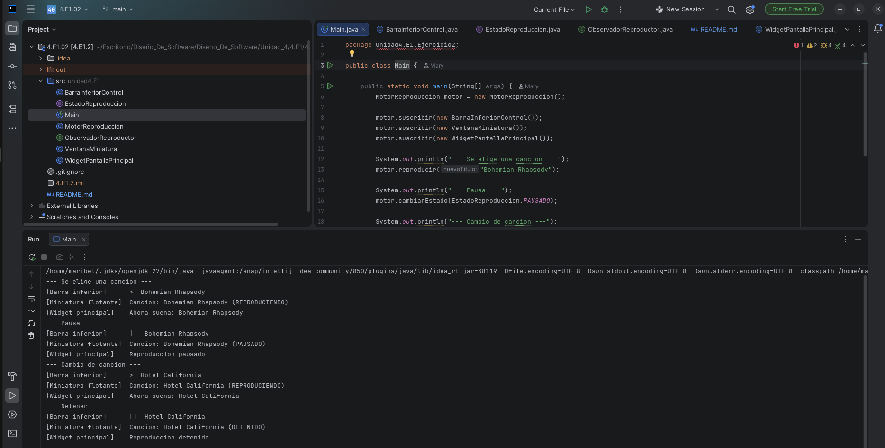

# Ejercicio 4.E1.02 – Reproductor de Música

## Descripción

Este ejercicio consiste en simular un reproductor de música que permite cambiar de canción y modificar su estado de reproducción.

Se utiliza el patrón de diseño Observer para que las distintas partes del reproductor reciban automáticamente las actualizaciones cuando cambia la canción o su estado.

## ¿Cómo funciona?

El motor de reproducción se encarga de guardar la canción actual y su estado. Cuando ocurre un cambio, notifica a todos los observadores que están suscritos.

Los observadores representan diferentes partes de la interfaz del reproductor, que muestran la información actualizada de distintas maneras.

## Clases del ejercicio

- **MotorReproduccion.java:** administra la canción actual, el estado de reproducción y la lista de observadores. También se encarga de enviar las notificaciones cuando hay cambios.

- **ObservadorReproductor.java:** es la interfaz que deben implementar las clases que reciben las actualizaciones del reproductor.

- **EstadoReproduccion.java:** define los tres estados posibles: reproduciendo, pausado y detenido.

- **BarraInferiorControl.java:** muestra la canción actual y un símbolo que representa el estado de reproducción.

- **VentanaMiniatura.java:** muestra el nombre de la canción y su estado en una ventana pequeña.

- **WidgetPantallaPrincipal.java:** muestra qué canción está sonando o informa si la reproducción está pausada o detenida.

- **Main.java:** contiene el método principal. Crea el reproductor, suscribe los observadores y realiza diferentes cambios para comprobar su funcionamiento.

## Resultado de la ejecución

Al ejecutar el programa, se selecciona la canción "Bohemian Rhapsody" y las tres vistas reciben la notificación.

Luego, el reproductor pasa al estado pausado. Después se cambia a la canción "Hotel California" y finalmente se detiene la reproducción.

En cada cambio, las tres vistas muestran la información actualizada.

## Captura del resultado

