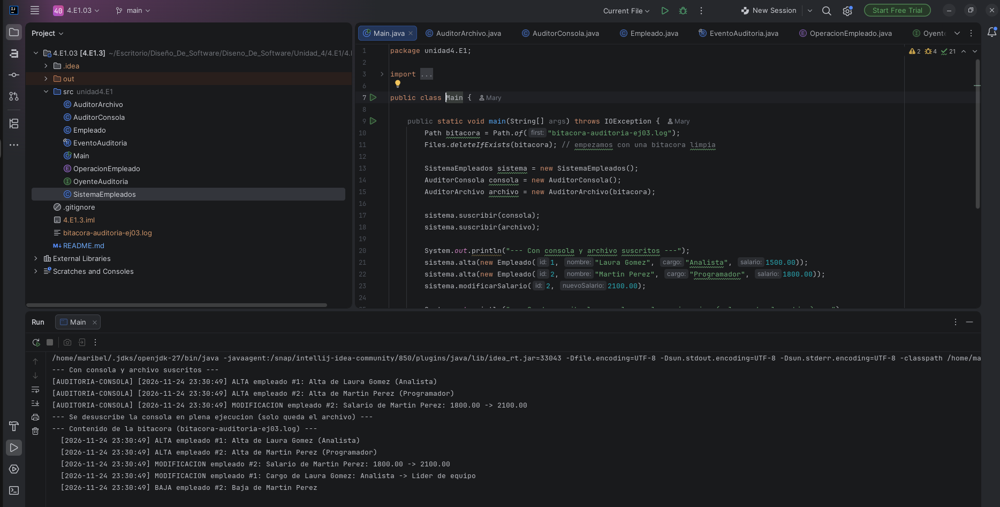

# Ejercicio 4.E1.03 – Sistema de Auditoría de Empleados

## Descripción

Este ejercicio consiste en un sistema que permite administrar empleados y registrar las operaciones que se realizan sobre ellos.

Se utiliza el patrón de diseño Observer para notificar automáticamente a los auditores cada vez que se realiza una operación, como dar de alta o de baja a un empleado, o modificar su salario o cargo.

## ¿Cómo funciona?

El sistema de empleados se encarga de administrar la información y notificar a los observadores cuando ocurre una operación.

En este caso, hay dos formas de recibir las notificaciones: mediante la consola y mediante un archivo de registro.

Al principio, ambos auditores están suscritos. Luego, durante la ejecución, se elimina el auditor de consola, por lo que las siguientes operaciones solamente quedan registradas en el archivo.

## Clases del ejercicio

- **SistemaEmpleados.java:** administra los empleados, permite realizar altas, bajas y modificaciones, y notifica a los auditores cuando ocurre una operación.

- **Empleado.java:** representa a cada empleado y almacena sus datos, como ID, nombre, cargo y salario.

- **OyenteAuditoria.java:** es la interfaz que deben implementar las clases que reciben las notificaciones.

- **EventoAuditoria.java:** representa la información de cada operación realizada, incluyendo el tipo de operación, el empleado involucrado, el detalle y la fecha y hora.

- **OperacionEmpleado.java:** define los tipos de operaciones posibles: alta, baja y modificación.

- **AuditorConsola.java:** recibe las notificaciones y muestra los registros de auditoría en la consola.

- **AuditorArchivo.java:** recibe las notificaciones y las guarda en un archivo de registro.

- **Main.java:** contiene el método principal. Crea el sistema, registra los auditores y realiza distintas operaciones para comprobar su funcionamiento.

## Resultado de la ejecución

Al ejecutar el programa, se crean dos empleados y se realizan diferentes operaciones sobre ellos.

Primero, las operaciones se muestran en la consola y también se guardan en un archivo. Después, se desuscribe el auditor de consola y se realizan nuevas modificaciones y una baja de empleado.

Finalmente, se muestra el contenido del archivo de auditoría, donde quedan registrados todos los eventos.

## Captura del resultado

