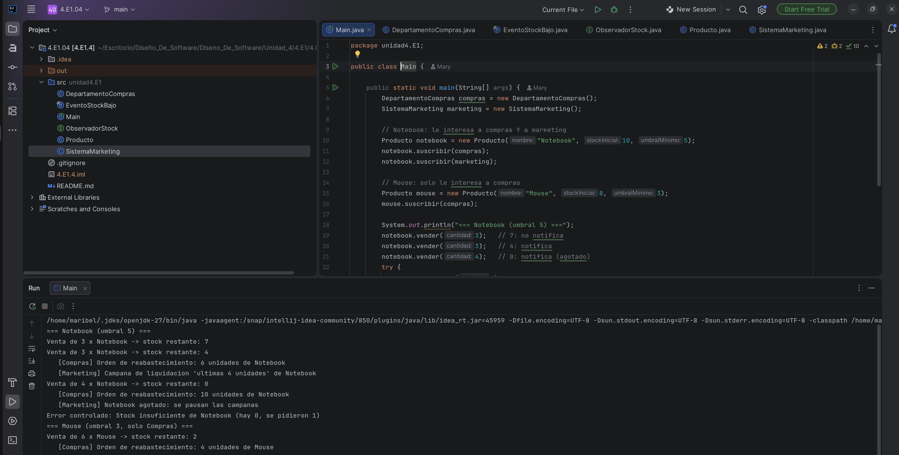

# Ejercicio 4.E1.04 – Control de Stock

## Descripción

Este ejercicio consiste en simular un sistema de control de stock de productos. Cuando la cantidad disponible de un producto baja por debajo de un mínimo establecido, se envía una notificación a los departamentos que están interesados en ese producto.

Para realizarlo se utiliza el patrón de diseño **Observer**, que permite que diferentes clases reciban avisos cuando ocurre un cambio.

## ¿Cómo funciona?

Cada producto tiene un nombre, una cantidad de stock y un umbral mínimo. Cuando se realiza una venta, el sistema descuenta las unidades correspondientes y verifica si el stock quedó por debajo del mínimo.

Si esto sucede, se notifica a los observadores registrados. En este caso, los departamentos de Compras y Marketing reciben la información y realizan diferentes acciones.

## Clases del ejercicio

- **Producto.java:** representa un producto y administra su stock. También permite registrar observadores y notificarles cuando el stock baja del mínimo establecido.
- **ObservadorStock.java:** es la interfaz que deben implementar las clases que quieran recibir notificaciones sobre el stock.
- **EventoStockBajo.java:** contiene la información del producto, el stock actual y el umbral mínimo.
- **DepartamentoCompras.java:** recibe las notificaciones y calcula cuántas unidades se deben pedir para reponer el stock.
- **SistemaMarketing.java:** recibe las notificaciones y muestra un mensaje según la situación del producto. Si está agotado, indica que se deben pausar las campañas.
- **Main.java:** contiene el método principal, donde se crean los productos, se registran los observadores y se realizan diferentes ventas para probar el funcionamiento.

## Resultado de la ejecución

Se crean dos productos: Notebook y Mouse.

La Notebook tiene registrados los departamentos de Compras y Marketing, mientras que el Mouse solamente tiene registrado el departamento de Compras.

Durante las ventas se observa que las notificaciones se envían cuando el stock queda por debajo del umbral mínimo. También se prueba qué sucede cuando un producto se agota y cuando se intenta vender una cantidad mayor a la disponible.

## Captura del resultado

