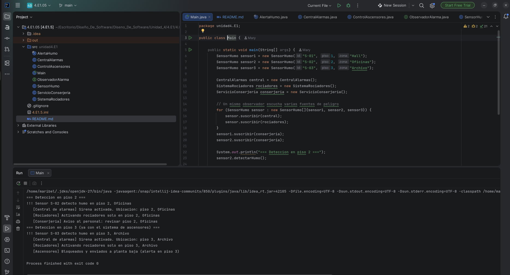

# Ejercicio 4.E1.05 – Sistema de Detección de Humo

## Descripción

Este ejercicio consiste en simular un sistema de seguridad para un edificio, donde diferentes sensores detectan la presencia de humo y envían alertas a los sistemas encargados de responder ante una emergencia.

Para desarrollarlo se utiliza el patrón de diseño **Observer**, que permite que varios sistemas reciban notificaciones cuando un sensor detecta humo.

## ¿Cómo funciona?

Se crean diferentes sensores ubicados en distintos pisos y zonas del edificio. Cada sensor puede tener registrados uno o varios observadores.

Cuando un sensor detecta humo, genera una alerta con la información de su ubicación y notifica a los sistemas que están suscritos.

Cada observador realiza una acción diferente, como activar la alarma, encender los rociadores o avisar al personal de conserjería.

Además, se incorpora un nuevo sistema para controlar los ascensores sin necesidad de modificar el código del sensor.

## Clases del ejercicio

- **SensorHumo.java:** representa un sensor ubicado en una zona del edificio. Detecta humo y notifica a los observadores registrados.
- **ObservadorAlarma.java:** es la interfaz que deben implementar los sistemas que reciben las alertas.
- **AlertaHumo.java:** contiene los datos de la alerta, como el identificador del sensor, el piso y la zona donde se detectó humo.
- **CentralAlarmas.java:** recibe las alertas y activa la sirena indicando la ubicación.
- **SistemaRociadores.java:** recibe las alertas y activa los rociadores en la zona correspondiente.
- **ServicioConserjeria.java:** recibe las alertas y avisa al personal para que revise el lugar.
- **ControlAscensores.java:** representa un nuevo sistema que bloquea los ascensores y los envía a planta baja cuando se detecta humo.
- **Main.java:** contiene el método principal, donde se crean los sensores, se registran los observadores y se simulan las detecciones de humo.

## Resultado de la ejecución

Se crean tres sensores ubicados en diferentes pisos del edificio: Hall, Oficinas y Archivo.

Primero se simula una detección de humo en el segundo piso. La central de alarmas, los rociadores y el servicio de conserjería reciben la notificación.

Después se incorpora el control de ascensores como un nuevo observador y se simula otra detección en el tercer piso. En este caso, se activan la central de alarmas, los rociadores y el control de ascensores.

## Captura del resultado

