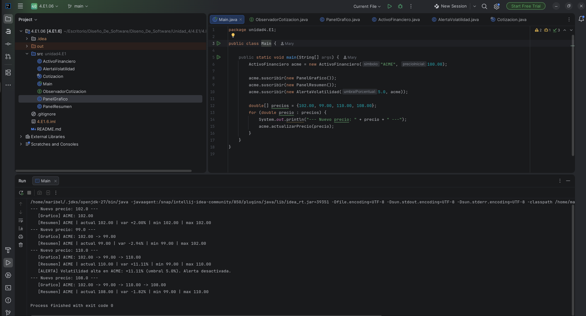

# 4.E1.06 - Paneles de Cotización de Bolsa

## Descripción

Este ejercicio implementa el patrón de diseño **Observer** para desarrollar un sistema que permite actualizar diferentes paneles informativos cuando cambia el precio de un activo financiero.

El objetivo es que varios componentes puedan recibir automáticamente las actualizaciones de una cotización, sin que el sistema tenga que comunicarse directamente con cada uno de ellos.

## ¿Cómo funciona?

El sistema utiliza un activo financiero llamado `ACME`, cuyo precio inicial es de 100.00.

Cuando se actualiza su precio, el activo calcula la variación porcentual respecto del precio anterior y notifica a todos los observadores registrados.

El programa cuenta con tres observadores:

- **PanelGrafico:** almacena los precios recibidos y muestra una secuencia que representa la evolución de la cotización.
- **PanelResumen:** muestra el precio actual, la variación porcentual y los valores mínimo y máximo registrados.
- **AlertaVolatilidad:** controla si la variación porcentual alcanza o supera un umbral del 5 %. Cuando esto sucede, muestra una alerta y se desuscribe automáticamente.

## Clases principales

- `ActivoFinanciero`: funciona como sujeto observable. Administra las suscripciones, actualiza el precio, calcula la variación porcentual y notifica a los observadores.
- `ObservadorCotizacion`: interfaz que establece el método `actualizar()` que deben implementar los observadores.
- `Cotizacion`: representa la información de una actualización mediante un objeto inmutable.
- `PanelGrafico`: recibe las cotizaciones y conserva la serie de precios.
- `PanelResumen`: presenta información resumida sobre la cotización.
- `AlertaVolatilidad`: detecta variaciones importantes y se desuscribe cuando se activa la alerta.
- `Main`: crea el activo financiero, registra los observadores y prueba diferentes actualizaciones de precio.

## Aplicación del patrón Observer

El patrón Observer permite que `ActivoFinanciero` informe los cambios de precio a todos los componentes suscritos sin conocer los detalles de cómo trabaja cada uno.

Cada observador recibe la misma información, pero realiza una acción diferente según su responsabilidad.

Además, se utiliza `CopyOnWriteArrayList` para administrar la lista de observadores de forma segura cuando se agregan o eliminan suscripciones durante una notificación.

## Ejecución del programa

La clase `Main` crea el activo financiero `ACME` con un precio inicial de 100.00 y registra los tres observadores.

Luego realiza las siguientes actualizaciones:

- 102.00
- 99.00
- 110.00
- 108.00

En cada actualización, los paneles reciben la nueva cotización. Cuando el precio pasa de 99.00 a 110.00, la variación supera el umbral del 5 %, por lo que se activa la alerta de volatilidad y esta deja de recibir futuras actualizaciones.

## Captura de ejecución

