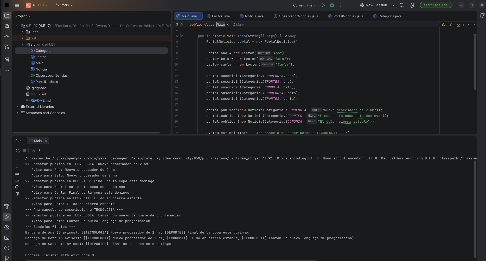

# 4.E1.07 - Sistema de Suscripciones a Noticias por Temática

## Descripción

Este ejercicio implementa el patrón de diseño **Observer** para desarrollar un portal de noticias en el que los lectores pueden suscribirse a diferentes categorías y recibir notificaciones cuando se publica una noticia relacionada con ellas.

El objetivo es que cada lector reciba únicamente las noticias de los temas que le interesan, sin necesidad de consultar constantemente el portal.

## ¿Cómo funciona?

El portal permite publicar noticias de tres categorías:

- **Tecnología**
- **Deportes**
- **Economía**

Los lectores pueden suscribirse a una o varias categorías. Cuando se publica una noticia, el portal notifica automáticamente a los lectores que están suscritos a esa temática.

También es posible cancelar una suscripción. A partir de ese momento, el lector deja de recibir notificaciones de esa categoría.

## Clases principales

- `PortalNoticias`: funciona como sujeto observable. Administra las suscripciones de los lectores por categoría y notifica a los correspondientes cuando se publica una noticia.
- `ObservadorNoticias`: interfaz que define el método `recibirNoticia()` que deben implementar los lectores.
- `Lector`: representa a un usuario del portal. Recibe las notificaciones y guarda las noticias en su bandeja.
- `Noticia`: representa una noticia mediante su categoría y título.
- `Categoria`: enumera las categorías disponibles: Tecnología, Deportes y Economía.
- `Main`: crea los lectores, establece sus suscripciones, publica noticias y muestra las bandejas finales.

## Aplicación del patrón Observer

El patrón Observer permite que el portal notifique automáticamente a los lectores cuando se publica una noticia de una categoría a la que están suscritos.

El portal no necesita conocer los detalles de cada lector ni cómo procesa las noticias. Solamente utiliza la interfaz `ObservadorNoticias` para enviar las notificaciones.

Además, las suscripciones se administran por categoría mediante un `EnumMap`, y se utiliza `CopyOnWriteArrayList` para manejar de forma segura la lista de observadores.

## Ejecución del programa

La clase `Main` crea tres lectores: Ana, Beto y Carla.

Cada uno se suscribe a diferentes categorías:

- Ana: Tecnología y Deportes.
- Beto: Economía y Tecnología.
- Carla: Deportes.

Luego se publican tres noticias, una por cada categoría. Cada lector recibe solamente las notificaciones correspondientes a sus suscripciones.

A continuación, Ana cancela su suscripción a Tecnología. Cuando se publica una nueva noticia de esa categoría, Ana ya no recibe la notificación, mientras que Beto sí.

Finalmente, se muestran las bandejas de los tres lectores con las noticias que recibió cada uno.

## Captura de ejecución

