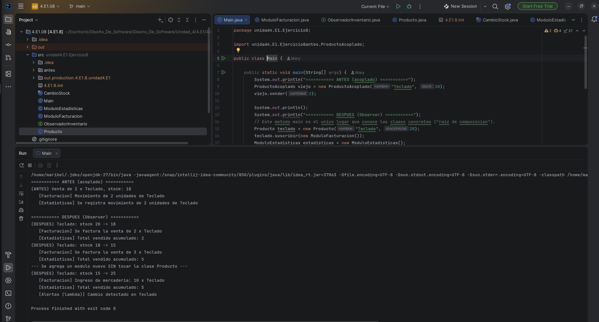

# 4.E1.08 - Refactorización de Código Acoplado utilizando Observer

## Descripción

Este ejercicio demuestra cómo mejorar el diseño de un programa mediante la aplicación del patrón de diseño **Observer**.

El objetivo es transformar un código inicialmente acoplado, donde una clase depende directamente de otros módulos, en una estructura más flexible y fácil de mantener.

Para demostrar esta transformación, se utiliza como ejemplo un sistema de inventario que administra los movimientos de stock de un producto y comunica esos cambios a diferentes módulos.

El ejercicio presenta dos versiones:

- **Antes:** una implementación con dependencias directas entre las clases.
- **Después:** una implementación que utiliza el patrón Observer para desacoplar los componentes.

## ¿Cómo funciona?

### Versión anterior: código acoplado

En la primera versión, la clase `ProductoAcoplado` tiene referencias directas a los módulos de facturación y estadísticas.

Cuando se realiza una venta, el producto modifica su stock y llama directamente a los métodos de ambos módulos para informar el movimiento.

Esto genera un acoplamiento fuerte, porque la clase `ProductoAcoplado` conoce a los módulos concretos y depende de ellos.

Si se quisiera agregar un nuevo módulo o modificar los existentes, sería necesario cambiar la clase del producto.

### Versión refactorizada: aplicación de Observer

En la segunda versión, la clase `Producto` ya no depende directamente de los módulos que reciben las notificaciones.

En su lugar, utiliza una interfaz llamada `ObservadorInventario`, que permite registrar diferentes observadores.

Cada vez que se vende o repone mercadería, el producto genera un objeto `CambioStock` con la información del movimiento y notifica automáticamente a todos los observadores registrados.

De esta manera, cada módulo puede realizar su propia tarea sin que el producto necesite conocer sus detalles internos.

## Clases principales

### Versión anterior

- `ProductoAcoplado`: administra el producto y su stock. También crea y llama directamente a los módulos de facturación y estadísticas.
- `ModuloFacturacionAcoplado`: recibe los movimientos del producto mediante una llamada directa.
- `ModuloEstadisticasAcoplado`: registra los movimientos realizados.

### Versión refactorizada

- `Producto`: funciona como sujeto observable. Administra el stock, permite registrar y eliminar observadores, y notifica los cambios cuando se vende o repone mercadería.
- `ObservadorInventario`: interfaz que define el método `alCambiarStock()` que deben implementar los observadores.
- `CambioStock`: representa la información de un movimiento, incluyendo el nombre del producto, el stock anterior y el stock nuevo. También permite calcular las unidades vendidas.
- `ModuloFacturacion`: implementa la interfaz `ObservadorInventario` y recibe los cambios para simular la facturación de ventas o el ingreso de mercadería.
- `ModuloEstadisticas`: implementa la misma interfaz y acumula la cantidad total de unidades vendidas.

## Aplicación del patrón Observer

El patrón Observer permite separar la administración del stock de las acciones que realizan los módulos cuando se produce un movimiento.

La clase `Producto` actúa como sujeto observable y mantiene una lista de observadores registrados.

Cuando se produce un cambio, genera un objeto `CambioStock` y notifica a todos los observadores mediante la interfaz `ObservadorInventario`.

Esto permite agregar nuevos módulos sin modificar la clase `Producto`, ya que solamente necesitan implementar la interfaz correspondiente y suscribirse al producto.

Además, se utiliza `CopyOnWriteArrayList` para administrar la lista de observadores de forma segura ante modificaciones durante las notificaciones.

## Ejecución del programa

La clase `Main` permite observar las diferencias entre las dos implementaciones.

Primero ejecuta la versión anterior:

1. Crea un producto llamado Teclado con un stock inicial de 20 unidades.
2. Realiza una venta de 2 unidades.
3. La clase `ProductoAcoplado` informa directamente el movimiento a los módulos de facturación y estadísticas.

Luego ejecuta la versión refactorizada:

1. Crea un producto llamado Teclado con un stock inicial de 20 unidades.
2. Registra los módulos de facturación y estadísticas como observadores.
3. Realiza una venta de 2 unidades y otra de 3 unidades.
4. Los módulos reciben automáticamente los cambios de stock.
5. Agrega un nuevo observador mediante una expresión lambda, sin modificar la clase `Producto`.
6. Realiza una reposición de 10 unidades y muestra que el nuevo observador también recibe la notificación.

## Resultado esperado

La ejecución permite comprobar que la versión anterior depende directamente de los módulos concretos, mientras que la versión refactorizada utiliza una interfaz para comunicar los cambios.

De esta manera, el patrón Observer reduce el acoplamiento, facilita la incorporación de nuevos componentes y permite que cada módulo tenga una responsabilidad independiente.

## Captura de ejecución

