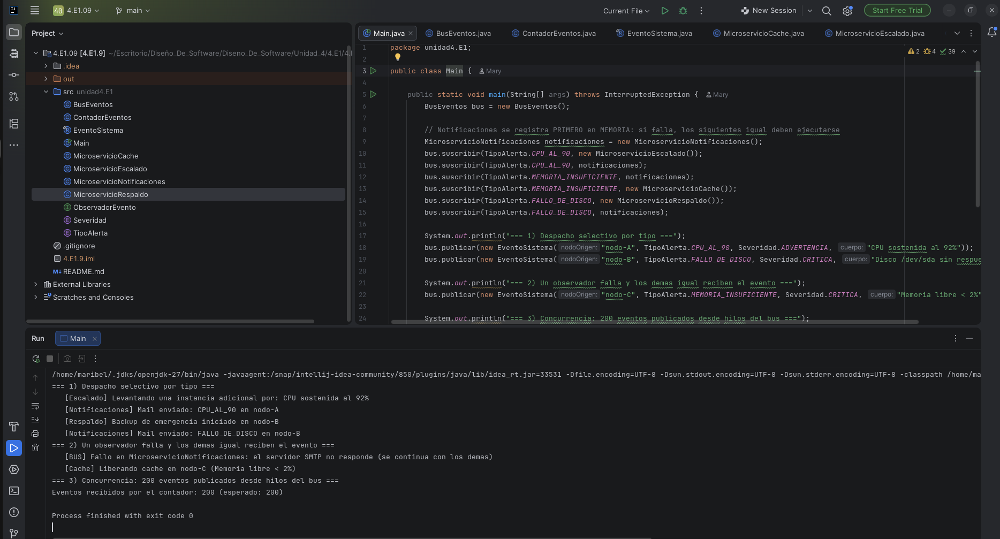

# 4.E1.09 – Motor de Eventos Avanzado para Microservicios

## Descripción

Este ejercicio consiste en desarrollar un motor de eventos que permita comunicar diferentes microservicios mediante el patrón de diseño **Observer**.

La idea principal es que un componente central, llamado `BusEventos`, publique eventos del sistema y que los microservicios interesados reciban esos eventos automáticamente, sin que el emisor tenga que conocerlos directamente.

El sistema permite realizar notificaciones selectivas según el tipo de alerta, manejar errores de los observadores y procesar eventos de manera concurrente.

## Objetivo

Aplicar el patrón Observer en un sistema de eventos que permita:

- Notificar a distintos microservicios cuando ocurre un evento.
- Enviar cada evento solamente a los observadores suscritos a su tipo de alerta.
- Evitar que el fallo de un observador interrumpa la notificación a los demás.
- Permitir la publicación de eventos de forma sincrónica y asincrónica.
- Trabajar con varios hilos de ejecución de manera segura.

## Aplicación del patrón Observer

En este ejercicio, `BusEventos` funciona como el sujeto que administra las suscripciones y distribuye los eventos.

Los microservicios implementan la interfaz `ObservadorEvento`, por lo que pueden suscribirse a los tipos de alertas que necesitan recibir.

Cuando se publica un evento, el bus busca los observadores registrados para ese tipo de alerta y les notifica lo ocurrido.

De esta manera, los microservicios pueden recibir información sin estar directamente acoplados entre sí.

## Estructura del proyecto

Las clases principales son:

- **BusEventos:** administra los observadores y distribuye los eventos según su tipo. Permite publicar eventos de forma sincrónica y asincrónica.
- **ObservadorEvento:** interfaz que deben implementar los componentes que desean recibir eventos.
- **EventoSistema:** representa un evento e incluye el nodo de origen, el tipo de alerta, la severidad y una descripción.
- **TipoAlerta:** enumera los tipos de alertas disponibles: CPU al 90 %, memoria insuficiente y fallo de disco.
- **Severidad:** define los niveles de importancia de un evento: información, advertencia y crítica.
- **MicroservicioNotificaciones:** recibe alertas y simula el envío de correos electrónicos. También permite probar qué sucede cuando un observador falla.
- **MicroservicioCache:** recibe determinados eventos y simula la liberación de la caché.
- **MicroservicioEscalado:** responde a las alertas de CPU simulando la creación de una instancia adicional.
- **MicroservicioRespaldo:** responde a los fallos de disco iniciando un respaldo de emergencia.
- **ContadorEventos:** cuenta la cantidad de eventos recibidos durante la prueba de concurrencia.

## Funcionamiento del sistema

El programa principal realiza tres pruebas:

### 1. Despacho selectivo de eventos

Se registran los microservicios según los tipos de alertas que necesitan recibir.

Luego se publican dos eventos:

- Una alerta de CPU al 92 % en el nodo A, que es recibida por los servicios de escalado y notificaciones.
- Una alerta de fallo de disco en el nodo B, que es recibida por los servicios de respaldo y notificaciones.

Esto demuestra que cada observador recibe únicamente los eventos a los que está suscrito.

### 2. Aislamiento de errores

Se publica una alerta crítica de memoria insuficiente en el nodo C.

El microservicio de notificaciones tiene un error simulado: cuando recibe una alerta crítica de memoria, lanza una excepción porque el servidor SMTP no responde.

Sin embargo, el bus captura ese error y continúa notificando a los demás observadores. Por eso, el microservicio de caché puede recibir y procesar el mismo evento aunque el servicio de notificaciones haya fallado.

### 3. Procesamiento concurrente

Se crea un segundo bus de eventos y se registra un `ContadorEventos` para escuchar las alertas de CPU.

Luego se publican 200 eventos de forma asincrónica, utilizando un grupo de cuatro hilos de ejecución.

Al finalizar, el programa muestra la cantidad de eventos recibidos por el contador. El resultado esperado es 200.

## Manejo de concurrencia y errores

Para permitir que el sistema trabaje con varios hilos, se utilizan distintas herramientas de Java:

- **ConcurrentHashMap:** permite administrar las suscripciones de manera segura cuando hay operaciones concurrentes.
- **CopyOnWriteArrayList:** permite recorrer las listas de observadores de forma segura mientras se realizan cambios en las suscripciones.
- **ExecutorService:** administra un grupo de cuatro hilos para procesar eventos de manera asincrónica.
- **AtomicInteger:** permite que el contador registre correctamente los eventos recibidos desde distintos hilos.

Además, `BusEventos` utiliza un bloque `try-catch` al notificar a cada observador. Así, si uno falla, el resto puede continuar procesando el evento.

## Resultado esperado

Al ejecutar el programa, se puede observar:

- La distribución selectiva de alertas según el tipo de evento.
- La respuesta de los distintos microservicios.
- El mensaje de error del servicio de notificaciones cuando falla el servidor SMTP.
- La continuidad de los demás observadores a pesar de ese error.
- El resultado de la prueba concurrente, con un total esperado de 200 eventos recibidos.

## Captura de pantalla

A continuación se muestra la captura de la ejecución del programa:

