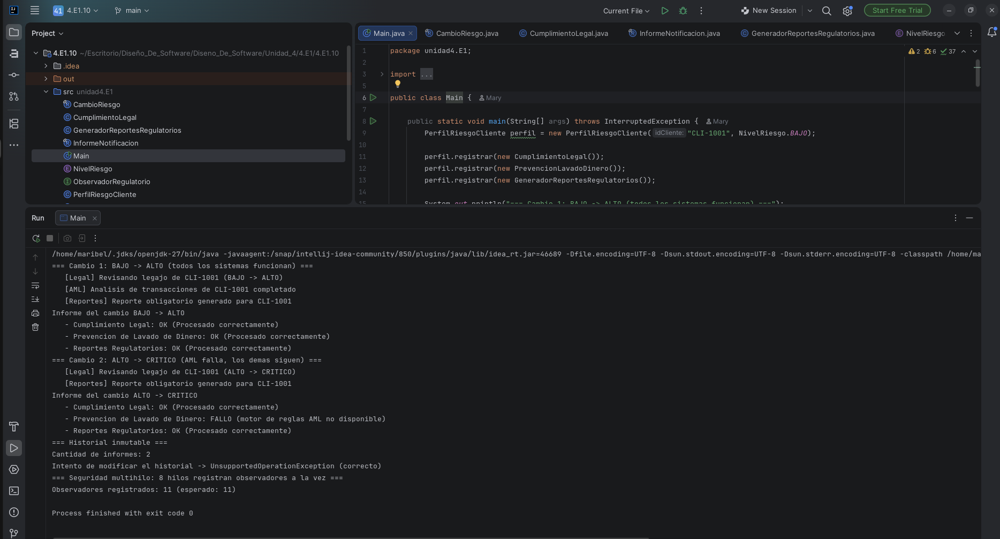

# 4.E1.10 – Sistema de Notificaciones de Cumplimiento Normativo y Riesgos

## Descripción

Este ejercicio consiste en desarrollar un sistema que permita notificar a distintos subsistemas regulatorios cuando cambia el nivel de riesgo de un cliente, utilizando el patrón de diseño **Observer**.

El sistema cuenta con un perfil de riesgo que informa automáticamente sus cambios a los observadores registrados. Estos pueden realizar diferentes tareas, como revisar información legal, analizar posibles operaciones de lavado de dinero y generar reportes regulatorios.

Además, se incorporan mecanismos para manejar errores, registrar los resultados de las notificaciones y trabajar de manera segura cuando varios hilos realizan operaciones al mismo tiempo.

## Objetivo

Aplicar el patrón Observer en un sistema de cumplimiento normativo que permita:

- Notificar a distintos subsistemas cuando cambia el nivel de riesgo de un cliente.
- Registrar y administrar los observadores interesados en recibir notificaciones.
- Evitar que el fallo de un observador interrumpa el funcionamiento de los demás.
- Mantener un historial de notificaciones que no pueda modificarse externamente.
- Permitir el registro concurrente de observadores de manera segura.

## Aplicación del patrón Observer

En este ejercicio, `PerfilRiesgoCliente` funciona como el sujeto observable, ya que administra los observadores registrados y comunica los cambios en el nivel de riesgo.

Los subsistemas implementan la interfaz `ObservadorRegulatorio`, que define los métodos necesarios para identificar a cada observador y procesar los cambios recibidos.

Cuando el nivel de riesgo de un cliente se modifica, el perfil genera un evento `CambioRiesgo` y notifica a todos los observadores registrados.

De esta manera, cada subsistema puede reaccionar al cambio sin que el perfil del cliente tenga que conocer los detalles internos de su funcionamiento.

## Estructura del proyecto

Las clases principales son:

- **PerfilRiesgoCliente:** representa el perfil de riesgo de un cliente. Administra los observadores, comunica los cambios de nivel y mantiene el historial de notificaciones.
- **ObservadorRegulatorio:** interfaz que deben implementar los subsistemas interesados en recibir los cambios de riesgo.
- **CambioRiesgo:** representa un cambio en el nivel de riesgo e incluye el identificador del cliente, el nivel anterior y el nuevo.
- **NivelRiesgo:** enumera los niveles de riesgo disponibles: bajo, medio, alto y crítico.
- **CumplimientoLegal:** representa el subsistema encargado de revisar el legajo del cliente cuando cambia su nivel de riesgo.
- **PrevencionLavadoDinero:** representa el subsistema encargado de analizar las transacciones. Tiene un error simulado cuando el nuevo nivel de riesgo es crítico.
- **GeneradorReportesRegulatorios:** representa el subsistema encargado de generar los reportes regulatorios correspondientes.
- **RegistroNotificacion:** almacena el resultado de la notificación a un observador, indicando su nombre, si la operación fue exitosa y el detalle correspondiente.
- **InformeNotificacion:** reúne el cambio de riesgo y los resultados de las notificaciones realizadas. Su contenido es inmutable.

## Funcionamiento del sistema

El programa principal realiza distintas pruebas para demostrar el funcionamiento del sistema.

### 1. Registro de observadores

Se crea un perfil de riesgo para el cliente `CLI-1001`, cuyo nivel inicial es bajo.

Luego se registran tres observadores:

- Cumplimiento Legal.
- Prevención de Lavado de Dinero.
- Generador de Reportes Regulatorios.

### 2. Cambio de nivel de riesgo

Se realizan dos cambios en el nivel de riesgo del cliente:

- **Primer cambio: BAJO → ALTO.** Los tres observadores reciben la notificación y procesan el cambio correctamente.
- **Segundo cambio: ALTO → CRITICO.** El subsistema de Prevención de Lavado de Dinero genera un error simulado porque su motor de reglas no está disponible.

A pesar de ese error, los otros observadores continúan funcionando. El sistema registra el resultado de cada notificación, diferenciando las operaciones exitosas de las fallidas.

### 3. Historial inmutable

Después de los cambios, se consulta el historial de informes generados.

El programa intenta modificar la lista recibida mediante el método `getHistorial()`. Como el historial es inmutable, se produce una excepción `UnsupportedOperationException`, que es capturada para demostrar que los registros no pueden alterarse desde afuera.

### 4. Seguridad multihilo

Por último, se crean ocho hilos que intentan registrar nuevos observadores al mismo tiempo.

El programa espera a que todos terminen y muestra la cantidad total de observadores registrados. El resultado esperado es 11: los tres observadores iniciales más los ocho agregados concurrentemente.

## Manejo de errores y concurrencia

Para garantizar un funcionamiento seguro, se utilizan diferentes herramientas de Java:

- **CopyOnWriteArrayList:** permite administrar de manera segura las listas de observadores y el historial cuando existen operaciones concurrentes.
- **synchronized:** se utiliza en el método `cambiarNivel()` para evitar que dos cambios simultáneos se mezclen durante el procesamiento y registro de las notificaciones.
- **try-catch:** permite capturar los errores de cada observador por separado, evitando que el fallo de uno interrumpa a los demás.
- **List.copyOf():** genera copias inmutables de las listas para impedir que se modifique el historial desde afuera.

Además, las clases `CambioRiesgo`, `RegistroNotificacion` e `InformeNotificacion` utilizan `record`, lo que permite representar los datos de forma sencilla e inmutable.

## Resultado esperado

Al ejecutar el programa, se puede observar:

- El registro de los tres subsistemas iniciales.
- La notificación de los cambios en el nivel de riesgo del cliente.
- El funcionamiento correcto de los observadores ante el primer cambio.
- El error simulado del subsistema de Prevención de Lavado de Dinero ante un nivel crítico.
- La continuidad de los demás observadores a pesar del error.
- La protección del historial frente a modificaciones externas.
- El registro concurrente de ocho observadores adicionales, alcanzando un total de 11.

## Captura de pantalla

A continuación se muestra la captura de la ejecución del programa:

