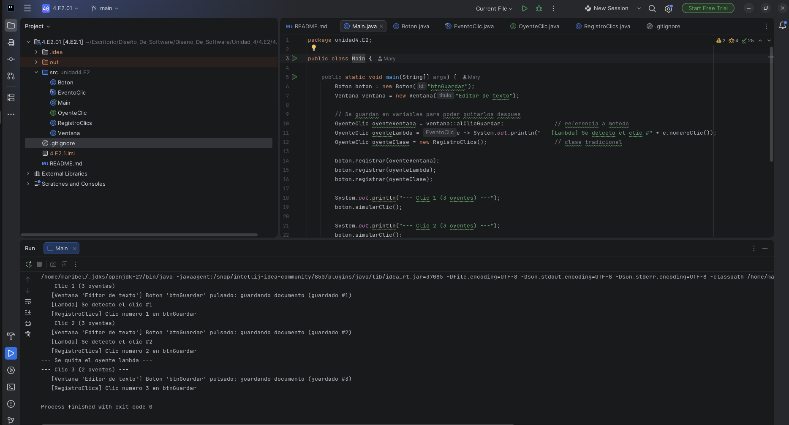

# 4.E2.01 – Notificador de Clic en Botón de Interfaz

## Descripción

Este ejercicio consiste en desarrollar un sistema de notificación que permita informar a distintos componentes cuando se produce un clic sobre un botón, utilizando el patrón de diseño **Observer**.

El botón funciona como sujeto observable y mantiene una lista de oyentes interesados en recibir notificaciones. Cada vez que se simula un clic, genera un evento con información del botón y del número de clic, y lo comunica a todos los oyentes registrados.

El sistema permite registrar y quitar oyentes sin que el botón tenga que conocer las clases concretas que reciben las notificaciones.

## Objetivo

Aplicar el patrón Observer para:

- Registrar diferentes oyentes interesados en los eventos de clic.
- Notificar automáticamente a todos los oyentes cuando se produce un clic.
- Permitir agregar y quitar oyentes.
- Evitar el acoplamiento entre el botón y las clases que reciben las notificaciones.
- Utilizar una interfaz común que permita registrar clases, expresiones lambda y referencias a métodos.

## Aplicación del patrón Observer

En este ejercicio, `Boton` funciona como el sujeto observable, ya que administra la lista de oyentes y se encarga de notificarles cada vez que ocurre un clic.

Los observadores utilizan la interfaz `OyenteClic`, que define el método `alHacerClic()` para recibir la información del evento.

Cuando se ejecuta `simularClic()`, el botón incrementa su contador, crea un objeto `EventoClic` y lo envía a todos los oyentes registrados.

De esta manera, el botón no necesita conocer qué acciones realiza cada oyente. Solamente se encarga de comunicar que ocurrió un clic.

## Estructura del proyecto

Las clases principales son:

- **Boton:** representa el sujeto observable. Administra los oyentes registrados, permite agregarlos y quitarlos, y notifica a todos cuando se simula un clic.
- **OyenteClic:** interfaz funcional que define el método `alHacerClic()`. Permite utilizar clases tradicionales, expresiones lambda y referencias a métodos como observadores.
- **EventoClic:** record que contiene la información del evento, incluyendo el identificador del botón y el número de clic.
- **Ventana:** representa una ventana que recibe los eventos mediante el método `alClicGuardar()`. Este método se registra como referencia a método, sin necesidad de que la clase implemente directamente la interfaz `OyenteClic`.
- **RegistroClics:** clase que implementa `OyenteClic` y muestra en consola el número de clic y el identificador del botón.
- **Main:** contiene el programa principal. Crea el botón y los observadores, realiza las pruebas de notificación y elimina uno de los oyentes.

## Funcionamiento del sistema

El programa principal realiza tres pruebas:

### 1. Registro de observadores

Se crea un botón con el identificador `btnGuardar` y una ventana llamada `Editor de texto`.

Luego se registran tres oyentes diferentes:

- La ventana, mediante una referencia a método.
- Una expresión lambda que muestra el número de clic detectado.
- Una instancia de la clase `RegistroClics`.

Esto demuestra que el sistema permite registrar distintos tipos de observadores utilizando una misma interfaz.

### 2. Notificación de los clics

Se simulan dos clics sobre el botón.

En cada uno, los tres observadores reciben el evento y realizan sus respectivas acciones:

- La ventana muestra que está guardando el documento.
- La expresión lambda informa el número de clic.
- `RegistroClics` muestra el identificador del botón y el número de clic registrado.

### 3. Eliminación de un observador

Luego se elimina la expresión lambda de la lista de oyentes.

Finalmente, se simula un tercer clic. Esta vez solamente reciben la notificación la ventana y la instancia de `RegistroClics`.

Esto demuestra que los observadores pueden dejar de recibir eventos cuando son eliminados del registro.

## Resultado esperado

Al ejecutar el programa, se puede observar:

- El registro de tres observadores diferentes.
- La notificación de los dos primeros clics a los tres oyentes.
- El funcionamiento de la ventana, la expresión lambda y la clase `RegistroClics`.
- La eliminación de uno de los observadores.
- La notificación del tercer clic solamente a los dos oyentes restantes.

## Captura de pantalla

A continuación se muestra la captura de la ejecución del programa:

