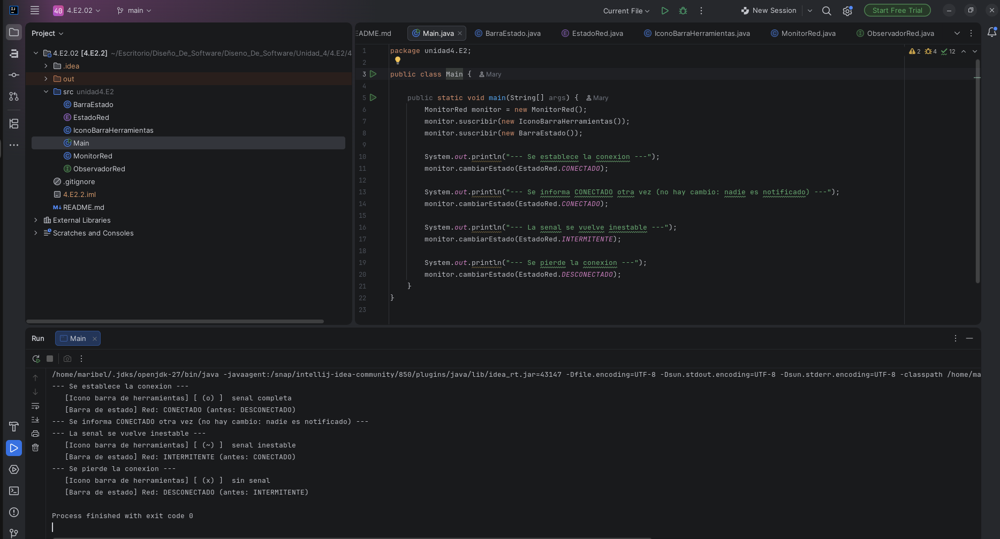

# 4.E2.02 – Indicador de Estado de Conexión de Red

## Descripción

Este ejercicio consiste en desarrollar un sistema que permita actualizar automáticamente los indicadores visuales del estado de una conexión de red, utilizando el patrón de diseño **Observer**.

El sistema cuenta con un monitor que controla el estado de la conexión y notifica a los componentes interesados cada vez que se produce un cambio.

De esta manera, tanto el icono de la barra de herramientas como la barra de estado pueden mostrar la información actualizada sin necesidad de consultar constantemente al monitor.

## Objetivo

Aplicar el patrón Observer para:

- Detectar los cambios en el estado de una conexión de red.
- Notificar automáticamente a los componentes interesados.
- Actualizar el icono y el texto del estado de conexión.
- Evitar consultas periódicas para comprobar si hubo cambios.
- Mantener la lista de observadores encapsulada y permitir su administración de manera segura.

## Aplicación del patrón Observer

En este ejercicio, `MonitorRed` funciona como el sujeto observable, ya que mantiene una lista de observadores y les comunica los cambios en el estado de la conexión.

Los observadores implementan la interfaz `ObservadorRed`, que define el método `alCambiarEstado()` para recibir el estado anterior y el nuevo.

Cuando se modifica el estado de la conexión, el monitor informa a todos los observadores registrados.

De esta manera, cada componente puede actualizar su información de forma independiente, sin que el monitor tenga que conocer los detalles de cómo se representa cada cambio.

## Estructura del proyecto

Las clases principales son:

- **MonitorRed:** representa el sujeto observable. Administra los observadores registrados y notifica los cambios de estado de la conexión.
- **ObservadorRed:** interfaz que define el método `alCambiarEstado()`, implementado por los componentes que desean recibir notificaciones.
- **EstadoRed:** enum que representa los posibles estados de la conexión: `CONECTADO`, `DESCONECTADO` e `INTERMITENTE`.
- **IconoBarraHerramientas:** observador que representa visualmente el estado de la conexión mediante distintos iconos y mensajes.
- **BarraEstado:** observador que muestra el estado actual de la red y el estado anterior.
- **Main:** contiene el programa principal. Registra los observadores y realiza diferentes cambios en el estado de la conexión para comprobar las notificaciones.

## Funcionamiento del sistema

El programa principal realiza distintas pruebas para demostrar el funcionamiento del sistema.

### 1. Registro de observadores

Se crea una instancia de `MonitorRed` y se registran dos observadores:

- `IconoBarraHerramientas`.
- `BarraEstado`.

Ambos quedan suscritos al monitor y reciben las notificaciones cuando cambia el estado de la conexión.

### 2. Cambio de estado de la conexión

El estado inicial de la conexión es `DESCONECTADO`.

Luego se realizan los siguientes cambios:

- **DESCONECTADO → CONECTADO:** los observadores reciben la notificación y muestran que la conexión está establecida.
- **CONECTADO → CONECTADO:** se vuelve a informar el mismo estado. Como no existe un cambio real, el monitor no envía ninguna notificación.
- **CONECTADO → INTERMITENTE:** los observadores muestran que la señal se volvió inestable.
- **INTERMITENTE → DESCONECTADO:** los observadores informan que se perdió la conexión.

### 3. Actualización automática

Cada vez que se produce un cambio real, los dos observadores reciben la información y actualizan su representación:

- El icono muestra si hay señal completa, señal inestable o ausencia de señal.
- La barra de estado informa el estado actual y el anterior.

Esto permite comprobar que ambos componentes se mantienen actualizados sin realizar consultas periódicas al monitor.

## Manejo de concurrencia

Para administrar las suscripciones de manera segura, se utilizan herramientas de Java:

- **CopyOnWriteArrayList:** permite almacenar y administrar los observadores de forma segura ante posibles operaciones concurrentes.
- **synchronized:** se utiliza en el método `cambiarEstado()` para evitar que dos cambios de estado simultáneos interfieran entre sí.

Además, el monitor solamente notifica cuando el nuevo estado es diferente del anterior, evitando notificaciones innecesarias.

## Resultado esperado

Al ejecutar el programa, se puede observar:

- El registro de los dos observadores.
- La actualización del icono y de la barra de estado cuando cambia la conexión.
- La información del estado anterior y el nuevo.
- La ausencia de notificaciones cuando se informa nuevamente el mismo estado.
- La actualización automática de los componentes sin necesidad de realizar consultas periódicas.

## Captura de pantalla

A continuación se muestra la captura de la ejecución del programa:

