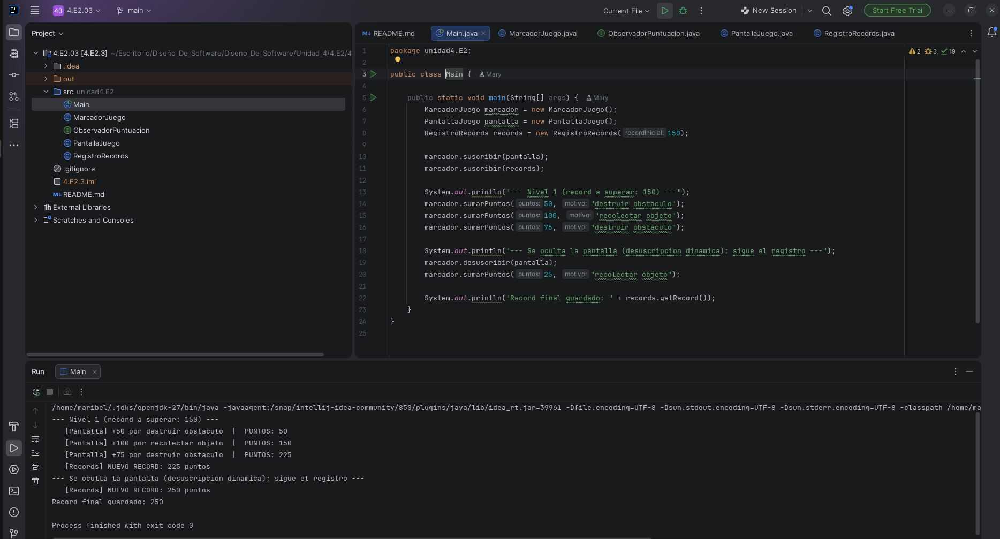

# 4.E.2 - Ejercicio 3: Sistema de Puntuación y Récords de un Videojuego

## Descripción

Este ejercicio consiste en desarrollar un sistema de puntuación para un videojuego, donde diferentes componentes necesitan conocer los cambios en los puntos obtenidos por el jugador.

Cada vez que el jugador gana puntos, el marcador actualiza la puntuación total y notifica automáticamente a los componentes que están suscritos. De esta manera, la pantalla puede mostrar los puntos obtenidos y el sistema de récords puede comprobar si se alcanzó una nueva puntuación máxima.

## Objetivo

Aplicar el patrón de diseño Observer para comunicar los cambios en la puntuación del juego a distintos componentes, sin generar una dependencia directa entre ellos.

## Aplicación del patrón Observer

En esta implementación, el patrón Observer permite que el marcador de puntuación informe a sus observadores cada vez que se suman puntos.

El marcador funciona como sujeto observable y mantiene una lista de los componentes interesados en recibir las notificaciones.

Los observadores implementan una interfaz común y reciben información sobre la puntuación total, los puntos ganados y el motivo por el cual se obtuvieron.

## Estructura del proyecto

El proyecto está compuesto por las siguientes clases:

- **MarcadorJuego:** administra la puntuación total del jugador. Permite suscribir y desuscribir observadores, sumar puntos y notificar los cambios.
- **ObservadorPuntuacion:** define la interfaz que deben implementar los componentes que desean recibir notificaciones sobre los cambios en la puntuación.
- **PantallaJuego:** representa el componente visual del videojuego. Muestra los puntos obtenidos y la puntuación acumulada.
- **RegistroRecords:** mantiene el mejor puntaje histórico y lo actualiza cuando la puntuación del jugador supera el récord anterior.
- **Main:** contiene el método principal y realiza una simulación del funcionamiento del sistema.

## Funcionamiento

Al iniciar el programa, se crean el marcador de puntuación, la pantalla del juego y el registro de récords, que comienza con un valor de 150 puntos.

Luego, la pantalla y el registro de récords se suscriben al marcador para recibir las notificaciones.

Durante la simulación se realizan las siguientes acciones:

1. El jugador obtiene 50 puntos por destruir un obstáculo.
2. Luego obtiene 100 puntos por recolectar un objeto, alcanzando un total de 150 puntos.
3. Después obtiene 75 puntos adicionales, llegando a 225. Como supera el récord inicial de 150, el sistema registra un nuevo récord.
4. La pantalla del juego se desuscribe del marcador, simulando que deja de estar visible.
5. Finalmente, el jugador obtiene 25 puntos más. El registro de récords continúa recibiendo las notificaciones y actualiza el máximo a 250 puntos.

Al finalizar, se muestra el récord guardado.

Además, el marcador valida que los puntos sumados sean positivos. Si se intenta agregar una cantidad menor o igual a cero, genera una excepción.

## Resultado esperado

El programa muestra cómo la pantalla recibe las actualizaciones mientras está suscrita y cómo el registro de récords continúa funcionando incluso después de que la pantalla deja de recibir notificaciones.

El resultado final debe indicar que el récord alcanzado es de 250 puntos.

## Captura de pantalla

