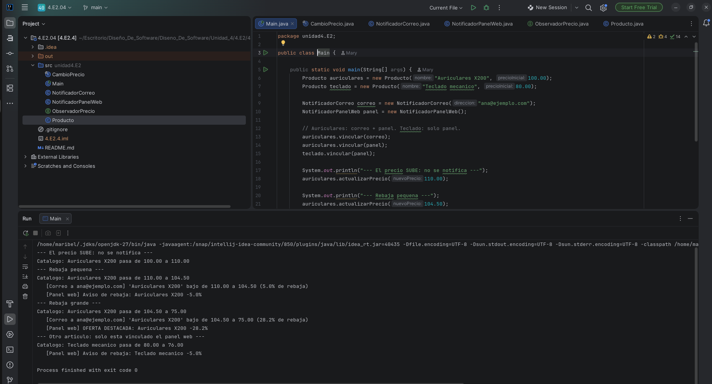

# 4.E.2 - Ejercicio 4: Notificación de Rebajas en una Lista de Deseos

## Descripción

Este ejercicio consiste en desarrollar un sistema que permite realizar un seguimiento de los precios de diferentes productos. Cuando el precio de un artículo disminuye, se notifica automáticamente a los canales que están vinculados con ese producto.

El sistema cuenta con dos tipos de notificaciones: una por correo electrónico y otra mediante un panel web. Además, el panel web distingue entre rebajas comunes y ofertas destacadas según el porcentaje de descuento aplicado.

## Objetivo

Aplicar el patrón de diseño Observer para notificar automáticamente los cambios de precio a diferentes componentes, permitiendo que cada producto tenga sus propios observadores.

## Aplicación del patrón Observer

En esta implementación, cada producto funciona como sujeto observable y mantiene una lista de los canales interesados en recibir notificaciones.

Cuando se actualiza el precio, el producto comprueba si el nuevo valor es menor al anterior. Si el precio aumenta, no se envían notificaciones. Si disminuye, se genera un objeto con la información del cambio y se comunica a los observadores vinculados.

De esta manera, los productos no necesitan conocer los detalles internos de cada sistema de notificación.

## Estructura del proyecto

El proyecto está compuesto por las siguientes clases:

- **Producto:** representa un artículo del catálogo. Administra su nombre, precio y lista de observadores. También permite vincular y desvincular canales de notificación.
- **ObservadorPrecio:** define la interfaz que deben implementar los componentes que reciben avisos cuando baja el precio de un producto.
- **CambioPrecio:** representa la información de una modificación de precio. Contiene el nombre del producto, el precio anterior y el nuevo, y permite calcular el porcentaje de rebaja.
- **NotificadorCorreo:** simula el envío de un correo electrónico con los datos de la rebaja y la dirección del destinatario.
- **NotificadorPanelWeb:** muestra las rebajas en el panel web y destaca las ofertas cuyo descuento es igual o superior al 20 %.
- **Main:** contiene el método principal y realiza las pruebas con distintos productos y canales de notificación.

## Funcionamiento

Al iniciar el programa, se crean dos productos: Auriculares X200, con un precio inicial de 100,00, y Teclado mecánico, con un precio inicial de 80,00.

Luego se crean los dos canales de notificación: un notificador por correo electrónico y un panel web.

Las suscripciones se organizan de la siguiente manera:

- Los auriculares están vinculados al correo electrónico y al panel web.
- El teclado está vinculado únicamente al panel web.

Durante la ejecución se realizan las siguientes pruebas:

1. El precio de los auriculares aumenta de 100,00 a 110,00. El sistema actualiza el precio, pero no envía notificaciones porque no se trata de una rebaja.
2. El precio disminuye de 110,00 a 104,50. Se notifica la rebaja a los dos canales vinculados.
3. El precio baja de 104,50 a 75,00. Se calcula el porcentaje de descuento y el panel web lo identifica como una oferta destacada porque supera el 20 %.
4. Finalmente, el precio del teclado disminuye de 80,00 a 76,00. En este caso, solamente recibe la notificación el panel web, ya que es el único canal vinculado a ese producto.

El sistema también valida que los precios sean mayores a cero. Si se intenta establecer un precio igual o menor a cero, se genera una excepción.

## Resultado esperado

El programa muestra los cambios de precio de cada producto y envía notificaciones únicamente cuando se produce una rebaja.

También permite comprobar que cada producto notifica solamente a sus propios observadores y que el panel web puede diferenciar una rebaja común de una oferta destacada.

## Captura de pantalla

