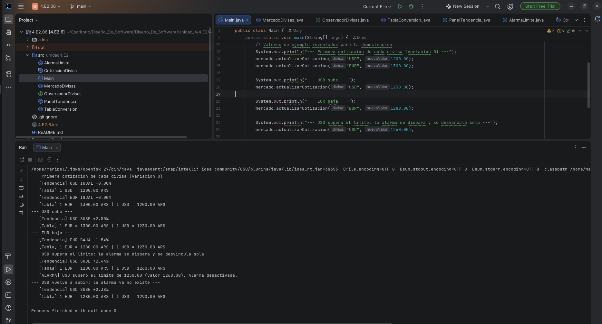

# 4.E.2 - Ejercicio 6: Panel Financiero de Variación de Divisas

## Descripción

Este ejercicio consiste en desarrollar un sistema que permite consultar y mostrar las variaciones de distintas divisas, como el dólar (USD) y el euro (EUR).

Cada vez que se actualiza la cotización de una divisa, el sistema calcula su variación porcentual con respecto al valor anterior y notifica automáticamente a los diferentes paneles que están suscriptos.

Además, cuenta con una alarma que se activa cuando una divisa supera un límite establecido. Una vez que se activa, la alarma se desuscribe automáticamente para no volver a recibir notificaciones.

## Objetivo

Comprender cómo utilizar el patrón de diseño Observer para distribuir información numérica que cambia frecuentemente desde un punto centralizado hacia diferentes componentes del sistema.

También se busca trabajar con varios observadores, calcular variaciones porcentuales y permitir que los suscriptores se agreguen o eliminen mientras se realizan las notificaciones.

## Aplicación del patrón Observer

En este ejercicio se utiliza el patrón Observer para que el mercado de divisas pueda comunicar los cambios en las cotizaciones a todos los componentes interesados, sin tener que conocer los detalles internos de cada uno.

El funcionamiento se organiza de la siguiente manera:

- **Sujeto:** `MercadoDivisas` administra las cotizaciones y los observadores suscriptos.
- **Observadores:** `PanelTendencia`, `TablaConversion` y `AlarmaLimite` reciben las actualizaciones.
- **Interfaz:** `ObservadorDivisas` establece el método que deben implementar los observadores.
- **Información compartida:** `CotizacionDivisa` contiene el nombre de la divisa, su valor actual y la variación porcentual.

Cuando se actualiza una cotización, el mercado crea un objeto `CotizacionDivisa` y lo envía a todos los observadores registrados.

## Estructura del proyecto

El ejercicio está compuesto por las siguientes clases:

- **MercadoDivisas:** es el sujeto principal. Guarda el último valor registrado de cada divisa, calcula la variación porcentual y notifica a los observadores.
- **ObservadorDivisas:** es la interfaz que define el método `alActualizar()`, que deben implementar los observadores.
- **CotizacionDivisa:** es un record que almacena la divisa, su valor y su variación porcentual.
- **PanelTendencia:** muestra si la cotización subió, bajó o se mantuvo igual, junto con el porcentaje de variación.
- **TablaConversion:** conserva y muestra los últimos valores conocidos de las distintas divisas, expresados en pesos argentinos.
- **AlarmaLimite:** controla si una divisa supera un límite establecido. Cuando esto sucede, muestra una alerta y se desuscribe automáticamente.
- **Main:** contiene el método principal y realiza las actualizaciones de cotizaciones para demostrar el funcionamiento del sistema.

## Funcionamiento del programa

Al ejecutar el programa, se crea un objeto `MercadoDivisas` y se registran tres observadores: el panel de tendencias, la tabla de conversión y la alarma configurada para el dólar, con un límite de $1250.

Luego se realizan diferentes actualizaciones para comprobar cómo responde cada componente:

1. **Primera cotización:** se registran los valores iniciales del dólar ($1200) y el euro ($1300). Como todavía no existe un valor anterior para comparar, la variación es del 0%.

2. **El dólar sube:** su cotización pasa de $1200 a $1230. El sistema calcula una variación positiva del 2,50% y los observadores reciben la actualización.

3. **El euro baja:** su valor pasa de $1300 a $1280. El panel indica una baja del 1,54% y la tabla actualiza su información.

4. **El dólar supera el límite:** la cotización pasa de $1230 a $1260. Como supera el límite establecido de $1250, se activa la alarma y muestra un mensaje. Después, se desuscribe automáticamente del mercado.

5. **Nueva actualización del dólar:** su valor pasa de $1260 a $1290. El panel de tendencias y la tabla reciben la actualización, pero la alarma ya no aparece porque se había desuscripto.

## Consideraciones técnicas

Para administrar los observadores se utiliza `CopyOnWriteArrayList`, una estructura que permite agregar o eliminar suscriptores de manera segura mientras se recorren los observadores para enviar notificaciones.

Esto es importante porque `AlarmaLimite` se desuscribe durante la misma notificación en la que se activa. De esta manera, se evita modificar una lista común mientras se está recorriendo.

Además, el mercado utiliza un `Map` para guardar el último valor de cada divisa y calcular su variación porcentual con respecto a la cotización anterior.

Los valores utilizados son de ejemplo y fueron definidos para demostrar el funcionamiento del ejercicio. No se consultan cotizaciones reales.

## Resultado de la ejecución

Al ejecutar el programa, se observa cómo los distintos componentes reciben las actualizaciones de las divisas, muestran sus variaciones y responden cuando el dólar supera el límite establecido.

