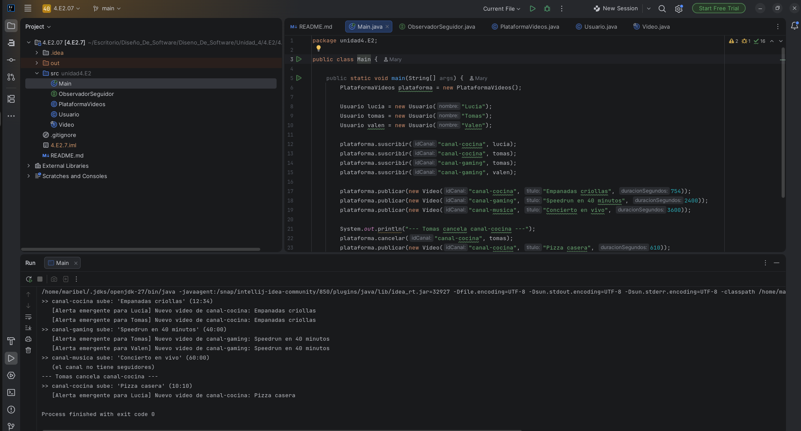

# 4.E.2 - Ejercicio 7: Sistema de Suscripción a Canales de Video Streaming

## Descripción

Este ejercicio consiste en desarrollar un sistema de suscripción a canales de video. Los usuarios pueden seguir diferentes canales y recibir una notificación cada vez que se publica un video nuevo.

Cada canal tiene su propia lista de seguidores. Por eso, cuando se publica un video, solamente reciben la notificación los usuarios que están suscriptos a ese canal.

También es posible cancelar una suscripción, de manera que el usuario deje de recibir notificaciones de ese canal.

## Objetivo

Comprender cómo aplicar el patrón de diseño Observer en un sistema que administra múltiples canales independientes, permitiendo que las notificaciones lleguen únicamente a los usuarios interesados.

Además, se busca trabajar con suscripciones y cancelaciones, utilizando una estructura que permita organizar los observadores según el canal al que pertenecen.

## Aplicación del patrón Observer

En este ejercicio se utiliza el patrón Observer para comunicar automáticamente a los usuarios cuando se publica un nuevo video en alguno de los canales que siguen.

El funcionamiento se organiza de la siguiente manera:

- **Sujeto:** `PlataformaVideos` administra los canales y sus respectivos seguidores.
- **Observadores:** los objetos `Usuario` reciben las notificaciones cuando se publica un video.
- **Interfaz:** `ObservadorSeguidor` define el método que deben implementar los usuarios para recibir las actualizaciones.
- **Información compartida:** `Video` contiene los datos del video publicado, como el identificador del canal, el título y la duración.

A diferencia de un sistema donde todos los observadores reciben las mismas notificaciones, en este caso cada canal tiene su propia lista de seguidores. De esta manera, la plataforma puede identificar quiénes deben recibir cada aviso.

## Estructura del proyecto

El ejercicio está compuesto por las siguientes clases:

- **PlataformaVideos:** es el sujeto principal. Administra las suscripciones de cada canal, permite agregar o cancelar seguidores y notifica a los usuarios cuando se publica un video.
- **ObservadorSeguidor:** es la interfaz que define el método `alSubirVideo()`, que deben implementar los usuarios para recibir las notificaciones.
- **Usuario:** representa a una persona suscripta a uno o varios canales. Cuando recibe una actualización, muestra un mensaje indicando que se publicó un nuevo video.
- **Video:** es un record que almacena el identificador del canal, el título y la duración del video. También incluye un método para mostrar la duración en minutos y segundos.
- **Main:** contiene el método principal y realiza las pruebas de suscripción, publicación y cancelación de canales.

## Funcionamiento del programa

Al ejecutar el programa, se crea una plataforma de videos y tres usuarios: Lucía, Tomás y Valen.

Luego se realizan las siguientes operaciones:

1. **Suscripciones iniciales:**
   - Lucía se suscribe al canal de cocina.
   - Tomás se suscribe al canal de cocina y al canal de gaming.
   - Valen se suscribe al canal de gaming.

2. **Publicación en el canal de cocina:** se publica el video "Empanadas criollas", con una duración de 12 minutos y 34 segundos. La notificación llega a Lucía y Tomás, porque ambos siguen ese canal.

3. **Publicación en el canal de gaming:** se publica el video "Speedrun en 40 minutos". La notificación llega a Tomás y Valen, que están suscriptos a ese canal.

4. **Publicación en el canal de música:** se publica el video "Concierto en vivo". Como ningún usuario está suscripto a ese canal, la plataforma informa que no tiene seguidores y no envía notificaciones.

5. **Cancelación de una suscripción:** Tomás cancela su suscripción al canal de cocina.

6. **Nueva publicación en cocina:** se publica el video "Pizza casera". Esta vez, solamente Lucía recibe la notificación, porque Tomás ya no está suscripto a ese canal.

## Consideraciones técnicas

Para organizar los seguidores se utiliza un `ConcurrentHashMap`, que permite asociar cada identificador de canal con su propia lista de observadores.

Además, cada lista utiliza `CopyOnWriteArrayList`, que permite agregar o eliminar seguidores de manera segura mientras se realizan las notificaciones.

El método `computeIfAbsent()` permite crear automáticamente una lista de seguidores cuando se registra una suscripción a un canal que todavía no tenía una.

De esta forma, la plataforma puede administrar varios canales de manera independiente y enviar cada notificación solamente a los usuarios correspondientes.

Las notificaciones se muestran en la consola para simular los avisos de una plataforma de streaming. No se implementa una aplicación real ni se envían notificaciones al dispositivo de los usuarios.

## Resultado de la ejecución

Al ejecutar el programa, se observa cómo cada usuario recibe las notificaciones de los canales a los que está suscripto. También se puede comprobar que, después de cancelar una suscripción, deja de recibir los avisos de ese canal.

