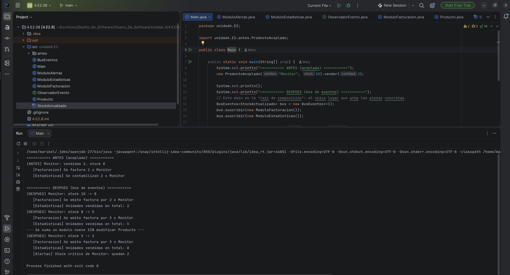

# 4.E.2 - Ejercicio 8: Refactorización de Código Acoplado hacia un Bus de Eventos

## Descripción

Este ejercicio consiste en mejorar un sistema de inventario que inicialmente tiene sus componentes demasiado relacionados entre sí.

En la primera versión, la clase `ProductoAcoplado` se encarga de administrar el stock y también crea y llama directamente a los módulos de facturación y estadísticas cada vez que se realiza una venta.

Este diseño genera un acoplamiento fuerte, porque si se necesita agregar un nuevo módulo o modificar uno existente, también hay que modificar la clase del producto.

Para solucionar este problema, se realiza una refactorización utilizando el patrón Observer mediante un bus de eventos. Así, el producto solamente administra su stock y publica un evento cuando se realiza una venta. Los módulos interesados reciben esa información sin que el producto necesite conocerlos.

## Objetivo

Comprender cómo reducir el acoplamiento entre las clases mediante el patrón Observer y un bus de eventos.

También se busca aplicar la inversión de control, separar responsabilidades y permitir que se incorporen nuevos módulos sin modificar la lógica principal del producto.

## Aplicación del patrón Observer

En la versión mejorada se utiliza un bus de eventos como intermediario entre el producto y los módulos que necesitan recibir información sobre los cambios de stock.

El funcionamiento se organiza de la siguiente manera:

- **Publicador:** `Producto` administra el stock y publica un evento cada vez que se realiza una venta.
- **Bus de eventos:** `BusEventos` recibe los eventos y los distribuye a los observadores registrados.
- **Observadores:** `ModuloFacturacion`, `ModuloEstadisticas` y `ModuloAlertas` reciben la información y realizan sus respectivas tareas.
- **Interfaz:** `ObservadorEvento` define el método que deben implementar los módulos interesados.
- **Información compartida:** `StockActualizado` contiene el nombre del producto, el stock anterior y el stock nuevo.

De esta manera, el producto no necesita saber qué módulos están escuchando ni qué hacen con la información recibida.

## Estructura del proyecto

El ejercicio está organizado en dos partes:

### Carpeta `antes`

Contiene la implementación original, donde existe un fuerte acoplamiento entre las clases.

- **ProductoAcoplado:** administra el stock, crea directamente los módulos de facturación y estadísticas y los llama después de cada venta.
- **FacturacionAcoplada:** simula la emisión de una factura por los productos vendidos.
- **EstadisticasAcopladas:** simula el registro de las unidades vendidas.

### Clases de la versión refactorizada

- **Producto:** administra el stock y publica un evento cuando se realiza una venta. Recibe el bus de eventos mediante su constructor.
- **BusEventos:** es el intermediario que administra los observadores. Permite suscribirlos, desuscribirlos y publicar eventos.
- **ObservadorEvento:** es una interfaz genérica que define el método `alOcurrir()`.
- **StockActualizado:** es un record que contiene los datos del cambio de stock.
- **ModuloFacturacion:** recibe el evento y simula la emisión de una factura según las unidades vendidas.
- **ModuloEstadisticas:** recibe el evento y acumula la cantidad total de unidades vendidas.
- **ModuloAlertas:** es un módulo adicional que se incorpora posteriormente. Avisa cuando el stock llega al mínimo establecido o queda por debajo de ese valor.
- **Main:** contiene el método principal y demuestra primero el funcionamiento de la versión acoplada y luego el de la versión refactorizada.

## Funcionamiento del programa

Al ejecutar el programa, se realizan dos demostraciones para comparar ambas implementaciones.

### 1. Versión original: código acoplado

Primero se crea un producto llamado "Monitor", con un stock inicial de 10 unidades.

Se realiza una venta de 2 unidades. La clase `ProductoAcoplado` actualiza el stock y llama directamente a los módulos de facturación y estadísticas.

El stock queda en 8 unidades.

### 2. Versión mejorada: bus de eventos

Luego se crea un `BusEventos` y se registran dos observadores:

- `ModuloFacturacion`.
- `ModuloEstadisticas`.

Se crea un producto llamado "Monitor", con un stock inicial de 10 unidades, que recibe el bus mediante su constructor.

A continuación, se realizan dos ventas:

1. Se venden 2 unidades y el stock pasa de 10 a 8.
2. Se venden 3 unidades y el stock pasa de 8 a 5.

En cada operación, el producto publica un evento y los módulos reciben automáticamente la información.

El módulo de estadísticas acumula las unidades vendidas y muestra un total de 5.

### 3. Incorporación de un nuevo módulo

Por último, se incorpora `ModuloAlertas`, configurado con un stock mínimo de 3 unidades.

Se realiza una nueva venta de 3 unidades. El stock pasa de 5 a 2.

Como el nuevo stock es menor o igual al mínimo establecido, el módulo de alertas muestra un mensaje indicando que el producto tiene stock crítico.

Lo importante es que este nuevo módulo se agrega desde `Main`, sin modificar la clase `Producto` ni el funcionamiento del bus de eventos.

## Consideraciones técnicas

La principal diferencia entre las dos versiones es el nivel de acoplamiento.

En la versión original, `ProductoAcoplado` conoce y utiliza directamente las clases de facturación y estadísticas. Esto dificulta la incorporación de nuevas funcionalidades.

En la versión refactorizada, `Producto` solamente conoce el bus de eventos que recibe por constructor. Los módulos, por su parte, implementan una interfaz común y se registran en el bus.

Además, se utiliza `CopyOnWriteArrayList` para administrar los observadores de manera segura durante las notificaciones.

El bus es genérico (`BusEventos<E>`), por lo que puede utilizarse para distribuir distintos tipos de eventos, no solamente los relacionados con el stock.

Las operaciones de facturación, estadísticas y alertas se representan mediante mensajes en la consola. No se generan facturas reales ni se utiliza una base de datos.

## Resultado de la ejecución

Al ejecutar el programa, se puede observar la diferencia entre el diseño original y el refactorizado.

También se comprueba que es posible agregar un nuevo módulo de alertas sin modificar la clase que administra el producto.

