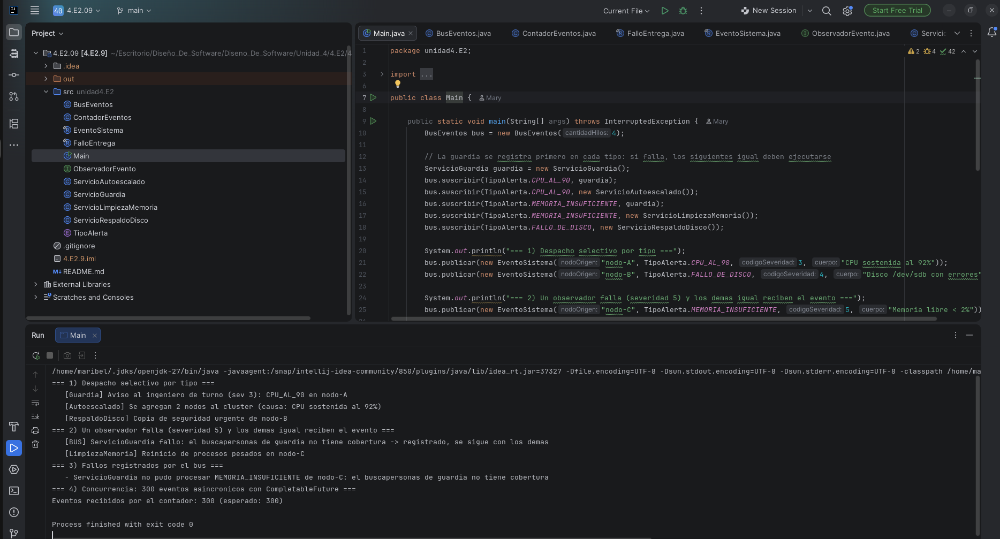

# 4.E2.09 - Bus de Eventos para Monitoreo de Servidores

## Descripción

Este ejercicio consiste en desarrollar un bus de eventos para monitorear distintos servidores y gestionar alertas del sistema.

Cuando ocurre un problema, como un uso elevado del procesador, falta de memoria o un fallo de disco, se genera un evento que es enviado únicamente a los servicios que están suscriptos a ese tipo de alerta.

El sistema también contempla situaciones en las que un servicio falla al procesar un evento. En lugar de interrumpir toda la comunicación, registra el error y continúa notificando a los demás observadores.

Además, permite publicar eventos de manera asíncrona, utilizando varios hilos para procesar múltiples notificaciones.

## Objetivo

Aplicar el patrón Observer mediante un bus de eventos que permita:

- Enviar notificaciones según el tipo de alerta.
- Mantener separados los servicios que generan eventos de los que los reciben.
- Evitar que el error de un observador interrumpa a los demás.
- Registrar los fallos que ocurren durante la entrega de eventos.
- Procesar múltiples eventos de manera concurrente.

## Aplicación del patrón Observer

El patrón Observer permite que distintos servicios reciban notificaciones cuando ocurre un evento, sin que el componente que publica la información tenga que conocer cómo funciona cada servicio.

En este ejercicio, el `BusEventos` funciona como intermediario entre los eventos del sistema y los servicios suscriptos.

Cada servicio implementa la interfaz `ObservadorEvento` y define qué acción realizar cuando recibe una notificación.

El bus organiza los observadores según el tipo de alerta, de manera que cada evento llegue solamente a los destinatarios correspondientes.

## Estructura del proyecto

El proyecto está compuesto por las siguientes clases:

- **BusEventos:** administra las suscripciones, distribuye los eventos según su tipo, registra los errores de entrega y permite publicar eventos de manera asíncrona.
- **EventoSistema:** representa un evento mediante el nodo de origen, el tipo de alerta, el código de severidad y una descripción. También valida que la severidad esté entre 1 y 5.
- **TipoAlerta:** enumera los tipos de alertas disponibles: CPU_AL_90, MEMORIA_INSUFICIENTE y FALLO_DE_DISCO.
- **ObservadorEvento:** interfaz que deben implementar los servicios que reciben los eventos. Define el método `alRecibir()`.
- **FalloEntrega:** registra la información de un evento que no pudo ser procesado por un observador, junto con el nombre del servicio y el error producido.
- **ServicioGuardia:** representa al servicio encargado de avisar al ingeniero de turno. Para probar el manejo de errores, falla cuando recibe una alerta con severidad 5.
- **ServicioAutoescalado:** simula la incorporación de dos nodos al clúster cuando se detecta un uso elevado de CPU.
- **ServicioLimpiezaMemoria:** simula el reinicio de procesos pesados cuando se detecta falta de memoria.
- **ServicioRespaldoDisco:** simula la realización de una copia de seguridad cuando ocurre un fallo de disco.
- **ContadorEventos:** cuenta la cantidad de eventos recibidos utilizando `AtomicInteger`. Se utiliza para comprobar el procesamiento concurrente.
- **Main:** crea los buses, registra los servicios, genera eventos y ejecuta las pruebas de manejo de errores y concurrencia.

## Funcionamiento

Al ejecutar el programa, se realizan cuatro pruebas principales:

**1. Despacho selectivo por tipo de alerta**

Se crea un bus de eventos con cuatro hilos y se registran los servicios correspondientes a cada tipo de alerta.

Primero se genera una alerta de CPU elevada en el nodo A. El bus notifica al servicio de guardia y al servicio de autoescalado.

Luego se genera un fallo de disco en el nodo B. En este caso, la notificación llega únicamente al servicio de respaldo de disco.

**2. Manejo de errores de los observadores**

Se genera una alerta de memoria insuficiente con severidad 5 en el nodo C.

El servicio de guardia produce una excepción para simular que no puede recibir la notificación porque su buscapersonas no tiene cobertura.

El bus captura ese error, lo registra y continúa con la entrega del evento. Por eso, el servicio de limpieza de memoria puede recibir la notificación aunque el servicio de guardia haya fallado.

**3. Registro de fallos**

El programa consulta los errores almacenados mediante `getFallos()` y muestra en pantalla qué observador falló, qué tipo de evento estaba procesando, de qué nodo provenía y cuál fue el motivo del error.

**4. Procesamiento concurrente**

Se crea un segundo bus de eventos con ocho hilos y se suscribe un contador de eventos.

Luego se generan 300 eventos de manera asíncrona utilizando `CompletableFuture`.

El programa espera a que todas las tareas terminen mediante `join()` y finalmente muestra la cantidad de eventos recibidos.

El resultado esperado es de 300 eventos procesados.

## Conceptos aplicados

En este ejercicio se trabajan los siguientes conceptos:

- **Patrón Observer:** permite notificar a diferentes servicios cuando ocurre un evento.
- **Bus de eventos:** funciona como intermediario entre quienes generan los eventos y quienes los reciben.
- **Despacho selectivo:** cada evento se envía solamente a los observadores registrados para su tipo de alerta.
- **Manejo de excepciones:** permite capturar los errores de cada observador sin interrumpir la entrega a los demás.
- **Estructuras concurrentes:** se utilizan `ConcurrentHashMap` y `CopyOnWriteArrayList` para administrar las suscripciones de forma segura.
- **Procesamiento asíncrono:** se utiliza `CompletableFuture` para ejecutar publicaciones sin bloquear el hilo principal.
- **ExecutorService:** administra el grupo de hilos que procesa las tareas.
- **AtomicInteger:** permite contar los eventos de forma segura cuando existen varios hilos trabajando.

## Resultado de la ejecución

Al ejecutar el programa, se puede observar cómo el bus distribuye las alertas según su tipo, cómo registra el fallo de un observador sin detener a los demás y cómo procesa los 300 eventos de manera concurrente.

El resultado final del contador debe indicar:

`Eventos recibidos por el contador: 300 (esperado: 300)`

## Captura de pantalla

A continuación se muestra la ejecución del programa:

