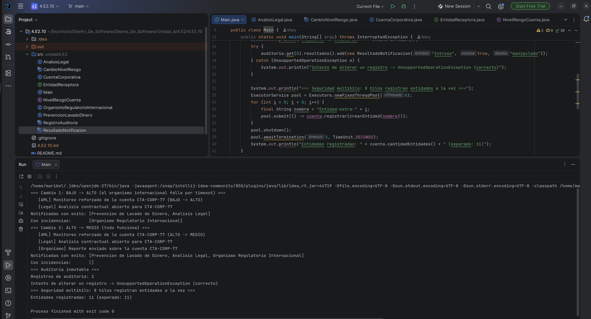

# 4.E2.10 - Sistema de Notificación de Cambios en el Nivel de Riesgo de Cuentas Corporativas

## Descripción

Este ejercicio consiste en desarrollar un sistema que permite notificar a distintas entidades cuando cambia el nivel de riesgo de una cuenta corporativa.

En un contexto financiero, una cuenta puede pasar de un nivel de riesgo bajo a uno medio, alto o crítico. Cuando esto sucede, diferentes áreas u organismos deben recibir la información para realizar las acciones correspondientes.

El sistema utiliza el patrón de diseño **Observer**, permitiendo que varias entidades estén registradas para recibir notificaciones cada vez que se modifica el nivel de riesgo de una cuenta.

Además, incorpora mecanismos para controlar errores durante las notificaciones, mantener un registro de auditoría inmutable y permitir el registro de entidades de forma segura cuando trabajan varios hilos al mismo tiempo.

## Objetivo

Aplicar el patrón Observer en un escenario empresarial, trabajando con los siguientes conceptos:

- Notificación de múltiples entidades ante un cambio de estado.
- Registro y eliminación de entidades receptoras.
- Manejo individual de errores durante las notificaciones.
- Registro de auditoría de los cambios realizados.
- Protección de los datos frente a modificaciones externas.
- Control de concurrencia mediante mecanismos de sincronización.

## Aplicación del patrón Observer

En este ejercicio, el patrón Observer permite que una cuenta corporativa informe a todas las entidades registradas cuando cambia su nivel de riesgo.

La clase `CuentaCorporativa` funciona como el sujeto observable, ya que mantiene una lista de entidades interesadas en recibir las notificaciones.

Las entidades receptoras implementan la interfaz `EntidadReceptora`, que define los métodos necesarios para identificarse y recibir los cambios.

Cuando se modifica el nivel de riesgo, la cuenta genera un objeto `CambioNivelRiesgo` con el identificador de la cuenta, el nivel anterior y el nuevo nivel. Luego, notifica a las entidades registradas.

De esta manera, la cuenta no necesita conocer los detalles internos de cada entidad ni las acciones que realiza después de recibir una notificación.

## Estructura del proyecto

El proyecto está compuesto por las siguientes clases:

- **CuentaCorporativa:** representa la cuenta observable. Administra las entidades registradas, permite agregarlas o quitarlas y notifica los cambios de nivel de riesgo.

- **EntidadReceptora:** interfaz que deben implementar las entidades interesadas en recibir notificaciones.

- **CambioNivelRiesgo:** record que contiene el identificador de la cuenta, el nivel de riesgo anterior y el nuevo nivel.

- **NivelRiesgoCuenta:** enum que define los niveles posibles de riesgo: BAJO, MEDIO, ALTO y CRITICO.

- **PrevencionLavadoDinero:** representa el área de prevención de lavado de dinero. Al recibir una notificación, informa que se realizará un monitoreo reforzado de la cuenta.

- **AnalisisLegal:** representa el área legal. Al recibir una notificación, informa que se inicia un análisis contractual.

- **OrganismoRegulatorioInternacional:** representa un organismo externo que recibe información sobre los cambios de riesgo. En este ejercicio, genera intencionalmente un error cuando el nuevo nivel es ALTO.

- **RegistroAuditoria:** almacena el cambio de riesgo y los resultados de las notificaciones realizadas. Sus datos no pueden modificarse después de su creación.

- **ResultadoNotificacion:** registra el nombre de la entidad, si la notificación fue exitosa y el detalle del resultado.

- **Main:** contiene el programa principal. Crea la cuenta, registra las entidades, realiza los cambios de riesgo y ejecuta las pruebas de auditoría y concurrencia.

## Funcionamiento

Al ejecutar el programa, se crea una cuenta corporativa identificada como `CTA-CORP-77`, cuyo nivel de riesgo inicial es BAJO.

Luego se registran tres entidades receptoras:

- Prevención de Lavado de Dinero.
- Análisis Legal.
- Organismo Regulatorio Internacional.

### 1. Primer cambio de nivel de riesgo

La cuenta cambia su nivel de riesgo de BAJO a ALTO.

Las tres entidades reciben la notificación. Sin embargo, el Organismo Regulatorio Internacional genera intencionalmente una excepción de tipo `TimeoutException`, simulando que se agotó el tiempo de espera al intentar comunicarse con él.

Este error no interrumpe el proceso completo, porque cada entidad se ejecuta dentro de su propio bloque `try-catch`.

Por lo tanto, las otras entidades pueden completar sus acciones y el sistema registra tanto las notificaciones exitosas como las que tuvieron inconvenientes.

### 2. Segundo cambio de nivel de riesgo

La cuenta cambia de ALTO a MEDIO.

En esta oportunidad, las tres entidades reciben correctamente la notificación, ya que el organismo internacional no genera el error para este nivel de riesgo.

El sistema registra los resultados de este segundo cambio.

### 3. Auditoría inmutable

Después de realizar los cambios, se consulta el registro de auditoría.

Este registro conserva la información de los cambios realizados y el resultado obtenido con cada entidad receptora.

La clase `RegistroAuditoria` utiliza `List.copyOf()` para crear una lista que no puede modificarse.

Para comprobarlo, el programa intenta agregar un resultado ficticio llamado "Intruso". Como la lista es inmutable, Java genera una excepción `UnsupportedOperationException`, que es capturada correctamente.

Esto permite comprobar que los registros de auditoría no pueden alterarse desde el exterior.

### 4. Seguridad multihilo

Por último, se realiza una prueba de concurrencia.

Se crea un `ExecutorService` con 8 hilos y se envían 8 tareas para registrar nuevas entidades en la cuenta al mismo tiempo.

Para proteger la lista de entidades, la clase `CuentaCorporativa` utiliza `ReentrantReadWriteLock`.

Este mecanismo permite que varias operaciones de lectura se realicen simultáneamente, mientras que las operaciones de escritura se ejecutan de manera exclusiva.

Al finalizar las tareas, el programa consulta la cantidad de entidades registradas.

El resultado esperado es 11: las 3 entidades iniciales más las 8 agregadas mediante los distintos hilos.

## Resultado esperado

Al ejecutar el programa, se deben observar los siguientes resultados:

- En el primer cambio, dos entidades son notificadas correctamente y el organismo internacional presenta un error por tiempo de espera agotado.
- En el segundo cambio, las tres entidades reciben correctamente la notificación.
- El sistema registra los dos cambios realizados en la auditoría.
- El intento de modificar un registro genera una `UnsupportedOperationException`, demostrando que la información es inmutable.
- Los 8 hilos registran nuevas entidades sin generar conflictos.
- Al finalizar, se obtiene un total de 11 entidades registradas.

## Captura de pantalla

A continuación se muestra la ejecución del programa:

